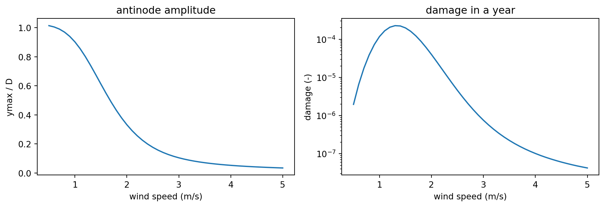

# dohl

Damage in overhead lines: fatigue damage of overhead line conductors under
aeolian vibration.

[](https://github.com/rte-france/pallas-dohl/actions/workflows/ci.yml)
[](https://github.com/rte-france/pallas-dohl/actions/workflows/docs.yml)
[](https://rte-france.github.io/pallas-dohl/coverage/)
[](https://rte-france.github.io/pallas-dohl/)

[](LICENSE)



## Features

- Energy balance: wind input power (CIGRE, Foti, OLLA and experimental fits
  from the EPRI Orange Book) against conductor self-damping (Foti, OLLA,
  Noiseux and empirical power laws), solved for the vibration amplitude.
- Fatigue damage: fictive stress at the clamp, from the antinode amplitude or
  from the Poffenberger-Swart amplitude; safe border line for single and
  multi-layer ACSR; number of cycles by quantile regression.
- Lifespan: yearly damage at a given wind speed, over a wind and tension
  history, or integrated over a Weibull wind distribution.
- Stockbridge dampers (experimental): dissipated power added to the energy
  balance.

## Installation

```shell
python -m pip install "dohl @ git+https://github.com/rte-france/pallas-dohl"
```

or, with [uv](https://docs.astral.sh/uv/):

```shell
uv add "dohl @ git+https://github.com/rte-france/pallas-dohl"
```

## Quick start

Yearly damage of an Aster 570 conductor at 15 % of its rated tensile
strength, for wind speeds from 0.5 to 5 m/s:

```python
import numpy as np

from dohl.lifespan import damage_year

# Aster 570: lineic mass (kg/m), external and last-strand diameters (m)
mu, D, d = 1.571, 3.105e-02, 3.45e-03
rts, young = 1.853e05, 6.8e10  # rated tensile strength (N), Young modulus (Pa)
EImin, EImax = 28.28, 2155.0  # bending stiffness range (N.m**2)
alpha = 0.140652  # limit curvature at full rated tensile strength (m**-1)

u = np.linspace(0.5, 5.0, 10)
tension = 0.15 * rts
ymax, yb, sigma, dmg = damage_year(
    u, tension, D, d, mu, young, EImin, EImax,
    multilayer=False, rts=rts, x0=alpha * tension / rts,
)
print("yearly damage per wind speed:", dmg)
```

## Documentation

- [Documentation](https://rte-france.github.io/pallas-dohl/): user guide,
  examples and API reference.
- [Examples](examples/): short scripts, each ending with its figures.
- [Coverage report](https://rte-france.github.io/pallas-dohl/coverage/).

## Development

The scripts `create_uvenv` (Linux) and `create_uvenv.ps1` (Windows) build a
development environment with uv. Otherwise:

```shell
uv sync --group dev
uv run pytest --cov=dohl --cov-report=term              # tests with coverage
uv run ruff check src/dohl tests && uv run ruff format --check src/dohl tests  # lint
```

Building the documentation is described in [CONTRIBUTING.md](CONTRIBUTING.md#documentation).

## Contributing and license

See [CONTRIBUTING.md](CONTRIBUTING.md) and the [code of conduct](code_of_conduct.md).
dohl is distributed under the [Mozilla Public License 2.0](LICENSE).

## Acknowledgements

dohl is developed by [Mews Labs](https://www.mews-labs.com) (formerly
Eurobios) and supported by [RTE R&D](https://www.rte-france.com/) via the
OLLA and PALLAS projects (see
[ResearchGate](https://www.researchgate.net/project/OLLA-overhead-lines-lifespan-assessment)).
